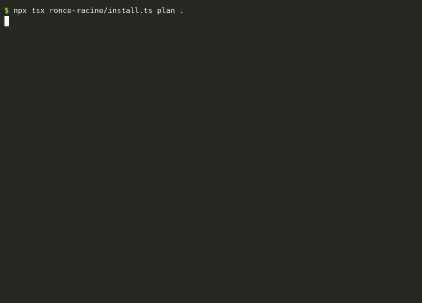

# Ronce Racine

[](https://www.npmjs.com/package/ronce-racine)
[](LICENSE)

**A personal [Claude Code](https://claude.com/claude-code) config, packaged so it
installs into any repository and stays up to date there.**

It is a set of habits I use every day, written down once and shipped by a CLI:

- **13 rules**, always on, injected by file type. The standing constraints an
  agent should never need to be reminded of.
- **36 skills**, on demand. Procedures the agent loads when what you asked for
  matches, from modeling a domain to triaging a bug.
- **6 hooks** (9 scripts), wired into `settings.json` for you. Small automatic
  behaviors on Claude Code events.
- **2 agents** and **1 detection script**, for the jobs that deserve their own
  context.

Not a framework and not a team product. One person's working setup, made
installable so twelve repositories cannot quietly become twelve different
configurations.

If you work across several repositories and keep telling Claude the same things,
this should save you the repeating. If you are looking for a team standard to
adopt wholesale, this is not one: take the parts you agree with.

[Quickstart](#quickstart) · [What you get](#what-you-get) · [How it is proven](#why-you-should-not-trust-the-tables-above) · [Staying in sync](#staying-in-sync) · [Install options](#install-options) · [Contributing](CONTRIBUTING.md)

## Why it is packaged at all

Copy-pasted `.claude/` config rots. You write a good rule in one project, paste
it into the next two, improve it in the third, and six months later no two
repositories agree. Nobody remembers which version came from where, and the CI
agent works from a config nobody has read since the day it landed.

So the config is a package: an installer that proposes only what a project's
stack justifies, a lockfile so a repository that drifts says so, and `detach`
for the artifacts you customized on purpose.

## Quickstart

```bash
npx ronce-racine plan .      # 1. read-only: what fits this repo, and why
npx ronce-racine install .   # 2. apply, then review the diff before committing
```



Nothing is written by `plan`. Here is a real run on a full-stack repository,
abridged:

```console
$ npx ronce-racine plan ./my-app
Analysis of ./my-app
Signals: git (.git/), ci (CI config), infra (Docker/infra), frontend (frontend dependencies), backend (Node backend dependencies), tests (E2E deps), code (sources detected)

✓ Recommended (installed by default):
  Rules (10) :
    • minimal-code - YAGNI + readability, any code project
    • secure-logging - GDPR: never log sensitive data
    • subscription-cleanup - frontend: subscription teardown
    • clean-architecture-deps - backend: dependency direction
    [... 6 more]
  Skills (23) :
    • recording-decisions - record non-obvious choices
    • commit-readiness-review - self-review before commit (+ scripts/precommit-scan.ts)
    • bug-triage-structured - full triage of a bug
    [... 20 more]
  Scripts (1) :
    • subscription-leak-scan.ts - detects subscriptions/listeners/timers without teardown
  Hooks (3) :
    • skill-reminder.ts - suggests the relevant skills for the prompt
    [... 2 more]
  Agents (2) :
    • code-reviewer - diff review agent
    • qa-tester - E2E testing agent

• Optional (add with --all):
  Rules (1) :
    • detection-gap-protocol - P0 found by user = detection failure
  Skills (12) :
    • audit-industrialisation - maturity audit orchestrator
    [... 11 more]
  Hooks (3) :
    • readme-freshness.ts - re-reads the README against what a push changes
    [... 2 more]
```

(The `[... n more]` lines mark where this transcript is abridged; a real run
prints every entry, then the exact install command to copy.)

Then `git add .claude && git commit`: the config travels with the repository, so
your teammates and your CI agent work from the same one you do.

> The installer runs code on your machine and wires hooks into your
> `settings.json`. [`SECURITY.md`](SECURITY.md) says exactly what runs and when.
> Worth two minutes before you install anything, here or anywhere else.

**Requirements**: Node 18 or later in the target repo. Hooks ship pre-built,
rules and skills are plain Markdown; only the optional detection scripts need
`npx tsx`. The hook wirings use the exec form (`"command": "node"` plus `args`)
and `${CLAUDE_PROJECT_DIR}`, which need **Claude Code 2.1.139 or later**
([changelog](https://github.com/anthropics/claude-code/blob/main/CHANGELOG.md):
`args: string[]` (exec form) landed there); the optional `readme-freshness`
hook also needs the `claude` CLI on PATH. Rules and skills alone have no such
floor.

## What you get

### Rules: the constraints that are always on

Rules are injected automatically based on the files in play, so they cost you
nothing to remember. Each one exists because forgetting it produced a real
defect.

| Rule | Applies to | What it prevents |
|---|---|---|
| `commits.md` | always | commit messages that nobody can scan six months later |
| `pre-commit-secret-detection.md` | always | a key or token reaching a commit, where a revert no longer saves you |
| `minimal-code.md` | code (rs/ts/tsx/vue/py/go) | speculative code, and its opposite: unreadable one-liners written to save a line |
| `error-handling-discipline.md` | code (ts/js/vue/py/go/rs/php/java) | swallowed errors, and a `panic`/`unwrap` on a fallible path |
| `doc-code-parity.md` | `README.md`, `docs/**` | a documented command that no longer matches the code, which the reader trusts anyway |
| `clean-architecture-deps.md` | code (ts/py/go/rs/php/java) | business logic leaking into handlers, dependencies pointing away from the domain |
| `no-raw-sql-interpolation.md` | code (ts/js/py/go/rs/php/java) | a query built by string concatenation, which is an injection |
| `sql-migrations-discipline.md` | `**/migrations/**` | a migration edited after it shipped, or one that cannot be replayed |
| `secure-logging.md` | `*.rs`, `*.ts` | an email, IP or token in the logs, which is a GDPR problem |
| `subscription-cleanup.md` | frontend (ts/tsx/js/jsx/vue) | subscriptions, listeners and timers with no teardown, and the leaks they cause |
| `ui-states-complete.md` | components (tsx/jsx/vue/svelte) | a screen that handles the happy path and shows nothing while loading or failing |
| `test-discipline.md` | `*.spec.ts`, `*.test.ts` | tests that pass without ever having been seen to fail |
| `detection-gap-protocol.md` | `docs/postmortems/**` | treating a P0 found by a user as a bug rather than as a detection failure |

### Skills: the procedures, loaded on demand

There is nothing to type. Each skill's description carries trigger phrases, and
the agent loads the one that matches what you asked for, in English or in
French. Five that show the character of the set:

| You say | What runs | What you get |
|---|---|---|
| *"this is broken: ..."* | `bug-triage-structured` | a reproduction, the root cause with `file:line`, then an argued fix-now-or-open-a-ticket decision |
| *"commit this"* | `commit-readiness-review` | the staged diff scanned for secrets, debug leftovers and disabled tests before anything is written |
| *"is it really ready?"* | `adversarial-feature-challenge` | the feature attacked from several personas; zero flaws found means a bad challenge, not a perfect feature |
| *"three names for the same thing here"* | `domain-glossary` | one name per concept in a `GLOSSARY.md`, the rejected synonyms recorded so a search for the wrong word still lands right |
| *"why is this slow?"* | `performance-profiling` | the noise floor measured before anything else, then a profile, with "inconclusive" as a valid answer |

The full set, grouped by intention:

| Group | Skills | For example |
|---|---|---|
| Designing, before code | 5 | `domain-modeling-design`, `comprehensive-test-strategy` |
| Implementing | 6 | `ddd-backend-implementation`, `api-contract-versioning` |
| Testing and validating | 4 | `writing-robust-tests`, `visual-regression-check` |
| Fixing a bug | 5 | `bug-triage-structured`, `production-incident-diagnostic` |
| Reviewing and shipping | 4 | `merge-request-review`, `ci-pipeline-orchestration` |
| Sweeping and auditing | 12 | `detection-sweep`, and the opt-in `audit-*` family |

What each one is for, in full: [`docs/catalog.md`](docs/catalog.md).


### Hooks: the small automatic behaviors

| Hook | Event | Why it is there |
|---|---|---|
| `skill-reminder.ts` | `UserPromptSubmit` | surfaces the skills matching your prompt, so a relevant one is not missed. Self-maintained, silent when nothing matches |
| `bash-npm-silent.ts` | `PreToolUse` / `Bash` | appends `--silent` to setup `npm install` / `npm ci`, which otherwise burn context on noise |
| `truncate-output.ts` (+ `truncate-bash-output.ts`) | `PreToolUse` / `Bash` | caps verbose command output past a threshold, always preserving it on error |
| `session-writer` + `session-inject` + `session-precompact` | `Stop` / `SessionStart(compact)` / `PreCompact` | a per-branch session memo: persists the context at session end and re-injects it after a compaction |
| `worktree-env-setup.ts` | `SessionStart` | symlinks the main repo's `.env` into the current worktree, so a worktree session is not born broken |
| `readme-freshness.ts` | `PreToolUse` / `Bash` | before a `git push`, has Claude re-read the README against the diff and report the claims it contradicts. Opt-in, warns without blocking |

Every hook fails open: it runs on every session of every repository that
installed it, so an error ends in a silent `exit 0` rather than blocking you.
The two to scrutinize before installing (`worktree-env-setup` symlinks your
`.env`, the session-memo trio writes to disk) are documented in
[`SECURITY.md`](SECURITY.md).

### Agents and scripts

- `code-reviewer`: architecture, reliability and correctness review of a diff.
  Read-only, and it ends on an actionable verdict.
- `qa-tester`: runs and writes E2E tests, favoring stable locators over timing
  hacks.
- `subscription-leak-scan.ts`: scans a staged frontend diff for subscriptions,
  listeners and timers with no teardown.

A project-specific agent or skill, coupled to your stack and your tracker, takes
precedence over its generic version here. Every generic skill says so up front.

## Why you should not trust the tables above

A skill nobody can trigger does not exist, and prose cannot be unit-tested. So
two things are mechanical here rather than hoped for.

**Routing is linted.** Ten realistic sentences must reach the right skill ahead
of the ones it is confusable with; half of them failed on the first run.

**Every skill is measured with and without itself.** Each carries a manifest
(fixture, prompt, gates derived from its own exit conditions, checks over what
the agent DID, a judge for the rest), and the two arms run as paired trials in a
container so the only difference between them is the skill. A skill prescribes
more than a deliverable - a script to run, a context to gather *before* acting,
an act to refrain from - and none of that survives into the final tree, so those
claims are graded from the agent's trajectory instead.
Each dimension is read on its own, never averaged, and no lift is claimed below
six pairs. It regularly says no: `refactoring-shared-component-api` is recorded
as no measurable lift after three attempts to find one.

What that costs and what else it caught:
[`docs/quality-bar.md`](docs/quality-bar.md) · how to run it:
[`docs/evaluating-skills.md`](docs/evaluating-skills.md).

## Staying in sync

```bash
npx ronce-racine check <repo>            # drift vs the canonical source
npx ronce-racine check <repo> --strict   # same, but fails CI
npx ronce-racine detach <repo> <token>   # exempt an artifact you customized on purpose
```

The lockfile records what was installed, `check --strict` turns drift into a
failing job, and `detach` keeps a deliberate local customization from having to
lie to the gate. Drop in the
[anti-drift CI job](templates/anti-drift.gitlab-ci.yml) and the config can no
longer rot silently.

Mechanics (the `settings.json` merge, the two distribution layers, the lockfile
states): [`docs/distribution-model.md`](docs/distribution-model.md) ·
[`docs/architecture.md`](docs/architecture.md).

## Install options

### The CLI (recommended)

```bash
npx ronce-racine plan    <repo>              # proposes, read-only
npx ronce-racine install <repo> [--all]      # applies (--all = + optionals)
npx ronce-racine install <repo> --yes        # no selector: the pre-checked set (CI, non-TTY)
npx ronce-racine install <repo> --pick <kind:name...>  # exactly these, e.g. skill:detection-sweep
npx ronce-racine install <repo> --rules-only # rules + lockfile only
npx ronce-racine check   <repo> [--strict]   # drift vs canonical (warns, or fails CI)
npx ronce-racine detach  <repo> <token>      # exempt a customized artifact from control
npx ronce-racine uninstall <repo> [--dry-run] # remove what it installed, nothing else
```

It copies into `<repo>/.claude/` and merges the hook wirings into
`settings.json` without disturbing what is already there. Full procedure:
[`docs/adopting-a-repo.md`](docs/adopting-a-repo.md).

Changed your mind? `uninstall` reverses it (`--dry-run` first), driven by the
lockfile so it removes what it installed and nothing else. It unwires its own hooks from `settings.json` and leaves the rest of that file
alone, keeps anything you `detach`ed, and gives you back any file it overwrote
on the way in.

Try it against throwaway repositories first with
[`playground/setup.ts`](playground/README.md).

### Or as a Claude Code plugin

```bash
/plugin marketplace add ChariereFiedler/ronce-racine
/plugin install ronce-racine@ronce-racine
```

The skills and the agents, subscribed rather than copied: they update when you
update the plugin, and nothing lands in your repository. The rules, the hooks
and the drift control are deliberately not in it, because always-on context and
code that runs on your machine belong in a reviewed diff. Reasoning:
[`docs/distribution-model.md`](docs/distribution-model.md).

### Or all three together

Once the [ronce mod](#the-ronce-mod-early-access) is installed, each layer has
one channel:

| Layer | Channel |
|---|---|
| Rules | the CLI, `install <repo> --rules-only`, versioned in the repository |
| Skills and agents | the `ronce-racine` plugin, user scope |
| Hooks | the `ronce` mod, driven by the repository's `.claude/ronce.json` |

To move an adopted repository over, run `uninstall` then
`install --rules-only`.

## The ronce mod (early access)

`mods/ronce/` is a Claude Code mod: one in-process plugin of function hooks,
meant to take over from a stack of command hooks. It checks tool calls against a
per-project policy, measures what output shaping would save, and writes one
JSONL telemetry file per turn under `~/.claude/ronce/events/`.

Version 0.2 enforces the unambiguous guards by default: shell reads of project
files, files created through a heredoc, a destructive git command chained after
`;`, Claude, AI or LLM in a commit message, and a `cd` to the current directory
(stripped). It shapes long successful outputs, keeping the whole of them under
`~/.claude/ronce/outputs/`. Every other rule starts in `shadow` mode, where it
records what it would have done and changes nothing; a project's policy
switches each rule with `"modes": { "<id>": "enforce" }`. It does the job of the
`truncate-output`, `bash-npm-silent` and `shell-read-guard` hooks: unwire those
where the mod runs.

Installed at the user scope, it runs in every project. A project without a
policy gets the engine's default rules; `"telemetry": null` in its policy turns
the event files off.

Version 0.3 also does what the session hooks did, each one a key of the policy:

| Key | What it does | Default |
|---|---|---|
| `worktree` | Links the main checkout's `.env` (or the files listed) into a linked worktree | on |
| `memo` | After a compaction, appends the branch, the ticket, the last request and a stale decisions file | on |
| `band` | A line above the prompt: project, branch, context, cost, budgets | on |
| `freshness` | Fetches the base branch at session start and warns when the local copy lags | off |
| `agentBudget` | Refuses a dev subagent past the open merge request or worktree cap; agent types that only read are exempt | off |
| `skillHints` | Adds a skill suggestion to a prompt that matches a pattern | none |
| `skillCatalog` | Otherwise, names the skills whose quoted triggers or name words the prompt holds, from the project's `.claude/skills` and the `ronce-racine` plugin's catalog; this is the `skill-reminder` hook | on, 3 at most |
| `checks.onEdit` | After an edit, runs the checks whose `match` fits the file and hands any finding to the model | rustfmt, ESLint, Biome on `scripts/`, ast-grep |
| `checks.background` | After a turn, runs the checks of the changed files in the background, once per state of those files; a finding wakes the session (at most `maxWakes` times in a row) | `vitest related` |

A check is a command with placeholders (`{file}`, `{rel}`, `{files}`, `{group}`), a directory, a timeout and
the rule that turns its output into a finding; it is skipped where its tool or its configuration is missing.
A check marked `deferIfBusy` waits for the next turn while a heavy process (`busyPattern`) runs, so two
sessions on the same machine do not compile at once; `onlyIfFilesContain` keeps a costly check for the
changes it is about (a SQL check for the files that hold a query).

Install it from a local clone. A folder marketplace is read in place, so what
runs is exactly what you have checked out, and `/reload-plugins` picks up an
edit:

```bash
claude plugin marketplace add /path/to/ronce-racine
claude plugin install ronce@ronce-racine
```

A project's rules live in its own `.claude/ronce.json`, in a reviewed diff like
any other code. Two tools work on that policy and on what the mod records:

```bash
npx tsx tools/ronce-policy.ts <repo>/.claude/ronce.json   # loads it as the mod does: rules, patterns, examples
npx tsx tools/ronce-report.ts --since 2026-10-08          # calls, failures, shell reads, repetitions, $ per 1 000 calls
```

In a session, `/ronce-hits` lists the rules that fired, shadow ones included.

## Contributing

One admission bar: an artifact lives here only if it is truly generic.

[`CONTRIBUTING.md`](CONTRIBUTING.md) for the bar and the workflow ·
[`docs/writing-a-rule.md`](docs/writing-a-rule.md) ·
[`docs/writing-a-skill.md`](docs/writing-a-skill.md) ·
[`docs/evaluating-skills.md`](docs/evaluating-skills.md) ·
[`docs/fixtures.md`](docs/fixtures.md) for where the eval fixtures come from ·
[`docs/measuring-prose.md`](docs/measuring-prose.md) for the method, reusable without this code ·
[`docs/developing.md`](docs/developing.md) for working on the toolkit itself ·
[`docs/decisions.md`](docs/decisions.md) for why things are the way they are ·
[`AGENTS.md`](AGENTS.md) if you *are* the agent reading this.

## The name

*Ronce Racine* is French for "bramble root", a plant that roots deep, spreads
everywhere and refuses to die. A fitting name for a layer of engineering
discipline meant to take hold in every repository, with just enough thorns to
remind you it says "discipline".

MIT licensed. Built by [Cedric Chariere Fiedler](https://github.com/ChariereFiedler).
