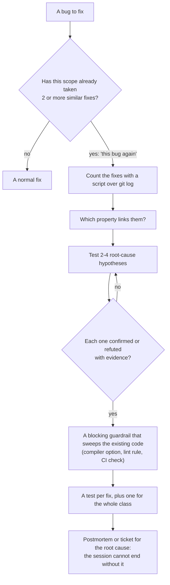
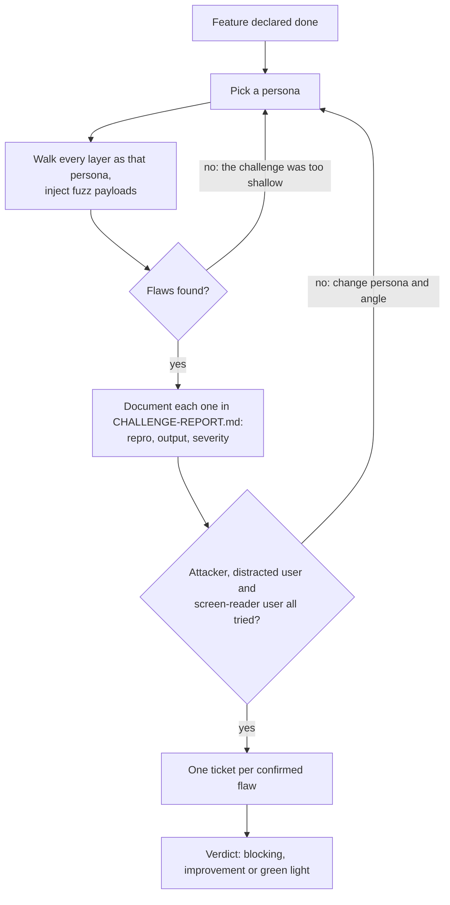
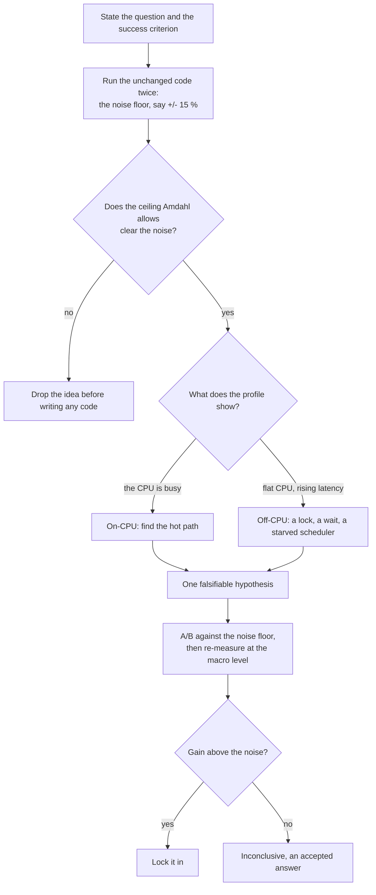
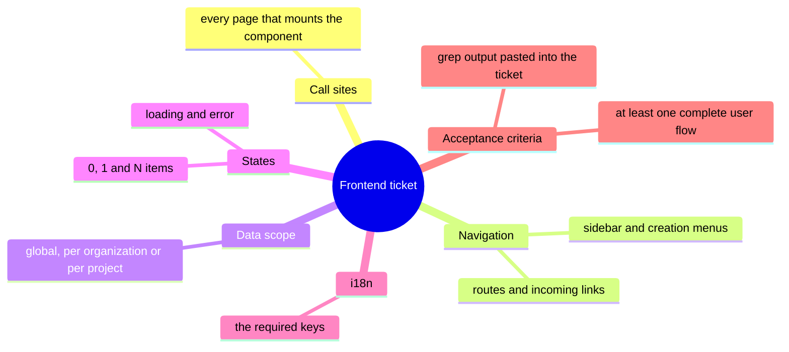
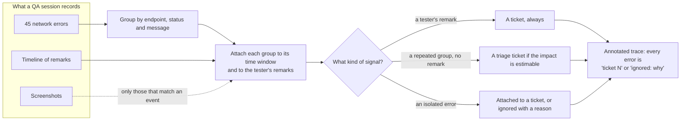
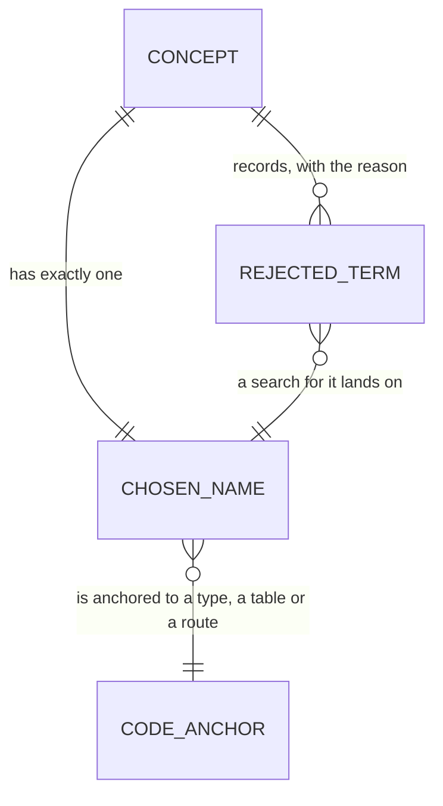
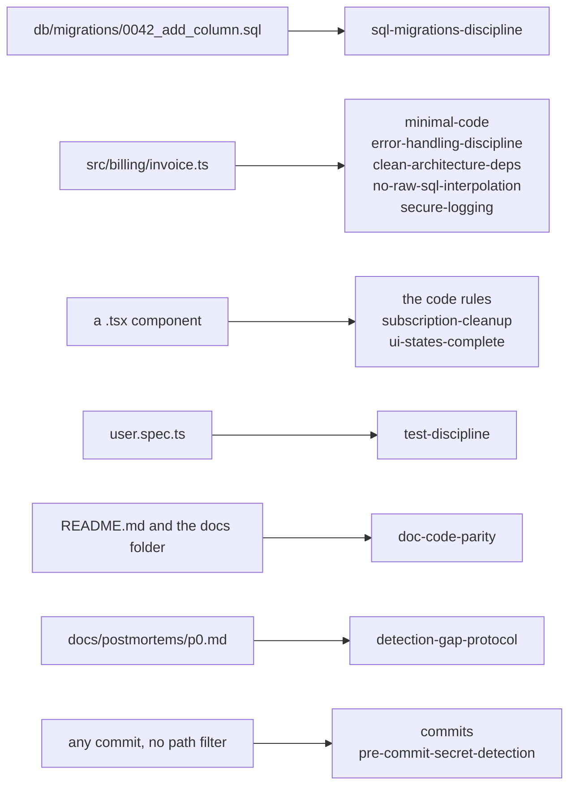
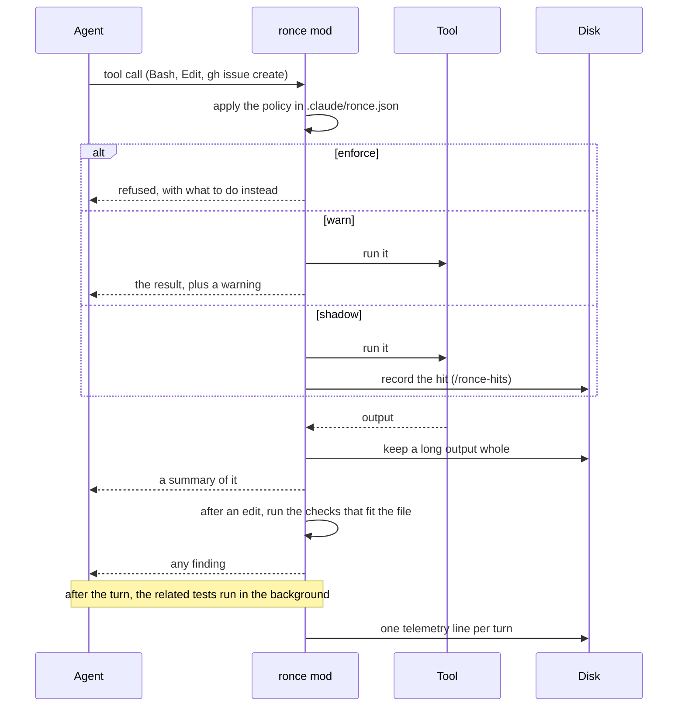
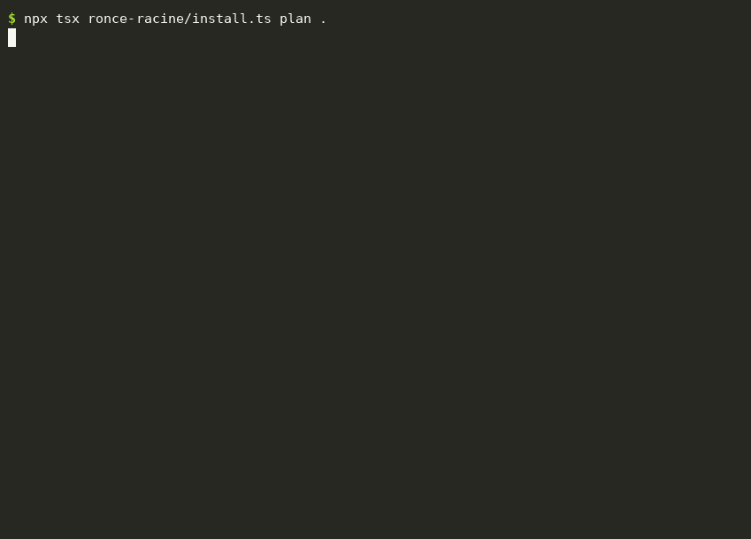

# Ronce Racine

[](https://www.npmjs.com/package/ronce-racine)
[](LICENSE)

**Your agent takes the fastest path, and you pay for it later. Ronce Racine
makes it take the right one, and keeps it there.**

The pain: left alone, an agent patches the same bug a fourth time, calls a
feature done because the happy path passes, files a ticket nobody can
reproduce. Each one looks like progress. Each one comes back as rework, a
regression found in review, or an incident.

The gain: the fix goes to the root cause, "done" means checked end to end, and a
ticket arrives with its evidence.

The set is built around one goal: an app you can run in production, not a demo
that works on your machine. The skills follow the steps that get an app there:
model the domain and implement it in layers, change the schema and the API
without breaking users, test and check a feature end to end, review and ship
through CI, audit security, observability, compliance and store review, then
diagnose the incident when production breaks anyway.

What sets it apart from a good `CLAUDE.md` is that it does not rely on the agent
remembering. A note in `CLAUDE.md` holds until the agent is in a hurry. Here each
constraint is placed where it cannot be skipped: a skill loads when your request
calls for it, a rule is injected when the files in play match, and the mod
refuses the tool call itself (an issue with no reproduction, a file read through
the shell) before it runs. In total: 37 skills, 13 rules, a few hooks, two
agents and the mod, installed into any repository.

It is one person's working setup. Take the parts you agree with; it is not a
standard to adopt wholesale.

[What's new](#whats-new-in-010) · [Six skills](#six-skills-worth-the-install) · [The mod](#the-ronce-mod-early-access) · [Which one do you need](#which-one-do-you-need) · [Install](#install) · [How it is proven](#how-it-is-proven) · [Docs](#docs) · [Contributing](CONTRIBUTING.md)

## What's new in 0.10

Version 0.10 is mostly about the `ronce` mod. It can now hold a project to its
own ticket form, and it warns when a session starts costing more than it
should.

- Your ticket form, enforced. Name the skill that writes your tickets and the
  headings a ticket must hold, in `.claude/ronce.json`. An issue created with
  `gh issue create` or `glab issue create` (or through the API, or with `curl`)
  whose body misses a heading is refused before it runs, and the message names
  the skill to load. It also refuses an issue until the session has searched
  the existing ones. [`docs/ticket-form.md`](docs/ticket-form.md) has the form,
  the commands it reads and its limits.
- Four signals that something is drifting. The session has passed 40, 60 or
  75 % of the context window. A `fix(...)` commit carries no ticket reference.
  The same ticket or scope has had a third fix in 48 hours (counted by default,
  a warning once a project sets `fixRepeat` to `enforce`). A `sleep` is being
  used to wait, when Monitor would do. None of them blocks anything.
- A skill for store review. `audit-store-review` checks an app's build, its
  store listing and its console declarations against Google Play's review rules
  before you submit.

The full list is in [`CHANGELOG.md`](CHANGELOG.md).

## Six skills worth the install

There are 37 skills, all listed in [`docs/catalog.md`](docs/catalog.md). You
never call them: each skill's description carries the phrases that load it, in
English or in French. These six show what the set is for.

### `recurring-bug-root-cause`: it will not write the fifth one-line fix

Ask an agent to fix a bug in a file that has taken three fixes this fortnight
and it writes a fourth. This skill fires on "this bug again" or on repeated fix
commits in one area, counts them with a script over `git log`, and stops the
patching. It asks for the shared cause and for a guardrail that is tooled and
blocking. A note in `CLAUDE.md` does not sweep the existing code and does not
survive the next distracted moment. The session cannot end until the root cause
has a trace, a ticket or a postmortem, even if the urgent fix shipped first. In
its evaluation, the blocking guardrail its exit condition asks for appeared in
0 of 7 runs without the skill and 7 of 7 with it.



### `adversarial-feature-challenge`: "I couldn't break it" is not a result

A green golden path proves one thing: the path the author already had in mind
works. This skill red-teams a feature declared done, as an attacker, a
distracted user and a screen-reader user. It tries double-clicks, an expired
session, another tenant's token, a 10,000-character name, a 500 from upstream.
Finding nothing counts as a sign the challenger was too shallow, so the loop
changes persona and angle. Every flaw leaves with a reproducible proof, a
severity and its own ticket.



### `performance-profiling`: measure the same code twice first

Before any profile, it runs the unchanged code twice to learn the noise floor.
A 5 % gain on a machine that wobbles by 15 % is no gain, whatever the p-value
says. It computes the ceiling Amdahl allows before a line is written, which
kills most bad ideas for free. It also knows that a CPU profile cannot see
waits: flat CPU with rising latency is the signature of a lock or a starved
scheduler. "Inconclusive" is an answer it accepts.



### `frontend-spec-call-site-audit`: no acceptance criteria until the graph is mapped

A ticket that describes a component alone produces a feature that works on its
own screen and breaks the screens around it: a component nobody mounts, a
sidebar entry that no longer routes, a missing "+ New". Before any frontend
ticket, this skill runs a six-point audit (call sites, incoming links, global
navigation, data scope, the 0, 1 and N-item states, i18n) and pastes the grep
results into the ticket. It refuses to draft acceptance criteria until that is
done, and at least one criterion has to be a full user flow.



### `qa-session-intake`: forty minutes of testing, a handful of real tickets

A recorded manual QA session is a noisy pile: a timeline of remarks,
screenshots, 45 network errors. One ticket per event drowns the signal, and one
mega-ticket never gets closed. The skill correlates first. It clusters errors by
endpoint, status and message, attaches them to what the tester said, then opens
one ticket per distinct problem. It keeps the network error the tester never
noticed, because a silently failing endpoint can be hiding data loss, and it
ends with a trace that accounts for every signal.



### `domain-glossary`: the line that says what we do not say

Three names for one concept is the cheapest way to make a codebase hard to
read, and every new module picks whichever the author saw last. The skill
harvests terms from the code, not from memory, then writes a `GLOSSARY.md` where
each concept has one name, anchored to a type, a table or a route. Its
distinctive part is the rejected terms. An entry records that `organization`
was considered and dropped, and why. That stops the next person reopening the
debate, and a search for the wrong word lands on the right entry.

An entry of the `GLOSSARY.md` it writes, and what it is tied to:



### The other 31

The six above are the ones that show the idea. The rest follow the same way of
working, in the order an app gets built. Every one is in
[`docs/catalog.md`](docs/catalog.md).

| Stage | Skills | In one line |
|---|---|---|
| Design | `domain-modeling-design`, `comprehensive-test-strategy`, `recording-decisions` | settle aggregates and invariants, pick test levels by risk, write a choice down while the reason is still known |
| Build | `ddd-backend-implementation`, `frontend-fullstack-implementation`, `design-system-component-lifecycle` | logic in the layer that owns it, no screen without its loading, error and empty states, no fourth one-off button |
| Change safely | `api-contract-versioning`, `database-schema-evolution`, `refactoring-shared-component-api` | a rename becomes a migration path, a risky schema change is planned before it runs, every call site is found |
| Verify | `writing-robust-tests`, `validating-features-end-to-end`, `visual-regression-check` | tests seen failing first, evidence pasted instead of "tests are green", the real render on desktop and mobile |
| Fix | `bug-triage-structured`, `bug-ticket-root-cause`, `production-incident-diagnostic` | reproduction and cause with `file:line`, a ticket with a red-then-green test, the faulty layer of a live system found fast |
| Ship | `commit-readiness-review`, `merge-request-review`, `ci-pipeline-orchestration` | a secret in the staged diff is a hard stop, review against intent, a pipeline checked and diagnosed after each push |
| Sweep and audit | `detection-sweep`, `daily-workflow-optimization`, `audit-industrialisation`, `audit-report`, `audit-store-review`, and 8 domain audits | a whole-project health check, cutting repeated manual steps, a periodic audit of architecture, CI/CD, compliance, observability, frontend performance, quality, security and testing, and Google Play review |

Rules and hooks are in
[`docs/rules-hooks-agents.md`](docs/rules-hooks-agents.md).

## Thirteen rules that are always on

Skills load when your request calls for them. Rules need no request: each one
is a Markdown file whose header lists the files it applies to, and Claude Code
puts it in context when the files in play match. You never have to remember
them, and each exists because forgetting it once produced a real defect.



| Family | Rules | What they prevent |
|---|---|---|
| Never leak | `pre-commit-secret-detection`, `no-raw-sql-interpolation`, `secure-logging` | a key in a commit, a query built by concatenation, an email or token in the logs |
| Code that stays readable | `minimal-code`, `error-handling-discipline`, `clean-architecture-deps` | speculative code, swallowed errors, business logic leaking into handlers |
| Data | `sql-migrations-discipline` | a migration edited after it shipped, or one that cannot be replayed |
| Interfaces | `subscription-cleanup`, `ui-states-complete` | listeners and timers with no teardown, a screen that shows nothing while loading or failing |
| Proof and memory | `test-discipline`, `doc-code-parity`, `detection-gap-protocol`, `commits` | tests never seen failing, a documented command that no longer matches the code, a P0 treated as a mere bug, a history nobody can scan |

Each rule's scope and its reason are in
[`docs/rules-hooks-agents.md`](docs/rules-hooks-agents.md). They reach a project
through the CLI, which commits them into the repository.

## The ronce mod (early access)

Skills advise. The mod acts. `ronce` is a Claude Code mod that sits on every
tool call of every session and applies a policy you keep in the repository, in
`.claude/ronce.json`.

By default it sends shell reads of project files back to the Read tool, refuses
to create a file through a heredoc, stops a destructive git command chained
after `;`, and blocks Claude, AI or LLM in a commit message. It shapes long
command output, keeping the whole of it on disk. After each edit it runs the
checks that fit the file (rustfmt, ESLint, Biome and ast-grep by default, each
skipped where its tool is missing) and hands any finding to the model. After a
turn it runs the tests related to the changed files in the background.

The ticket form and the four drift signals above are part of it. Its other
rules start in `shadow` mode: the rule records what it would have done and
changes nothing, until a project switches it to `enforce`. The mod also writes
one telemetry file per turn, which is where its defaults come from: the longest
sessions it measured reached 90 to 97 % of the context window.



| What it does | Default |
|---|---|
| Refuses a shell read of a project file, a file created through a heredoc, a destructive git command chained after `;`, Claude, AI or LLM in a commit message | enforced |
| Holds a project to its ticket form on issue creation | off until the policy names the skill and the headings |
| Warns that the context passed 40, 60 and 75 %, that a `fix(...)` commit has no ticket, that a `sleep` is a poor wait, and counts a third fix of the same scope in 48 h | on, never blocks |
| Runs the checks that fit an edited file, and the related tests after a turn | on, skipped where a tool is missing |
| Keeps the session usable: links the main checkout's `.env` into a worktree, restores the branch, ticket and last request after a compaction, names the skills a prompt calls for | on |
| Writes the telemetry that its defaults come from | on, `"telemetry": null` turns it off |

It is a 0.x release, hence the "early access". Every key, every default and the
checks are in [`docs/the-ronce-mod.md`](docs/the-ronce-mod.md).

## Which one do you need

Ronce Racine reaches a project through three channels. They do different jobs
and they stack.

| | CLI: `npx ronce-racine` | Plugin: `ronce-racine` | Mod: `ronce` |
|---|---|---|---|
| Brings | rules, skills, hooks, agents, scripts | skills and agents | guardrails, output shaping, checks, telemetry |
| Lives in | the repository's `.claude/`, committed | your user settings, nothing in the repository | your user settings; its policy is in the repository's `.claude/ronce.json` |
| Reaches | everyone who clones the repository, and CI | you | you, in every project |
| Stays current | `check` shows the drift, `install` resyncs it | `claude plugin update` | `claude plugin update`, then restart `claude` |
| Runs code on your machine | the installer, and the hooks it wires | no hooks | yes, in every session |
| Pick it when | a team and CI should share one config | you want the skills without touching a repository | you want bad tool calls refused, not just discouraged |

A repository that wants all three gives each layer one channel:

| Layer | Channel |
|---|---|
| Rules | the CLI, `install <repo> --rules-only`, versioned in the repository |
| Skills and agents | the `ronce-racine` plugin, user scope |
| Hooks | the `ronce` mod, driven by the repository's `.claude/ronce.json` |

The mod carries no rules: its guardrails act on tool calls, while the rules are
Markdown context that shapes the code the agent writes, so they still come from
the CLI. The mod also does the job of most of the CLI's hooks, so running both
means every call is handled twice. The reasoning behind the split:
[`docs/distribution-model.md`](docs/distribution-model.md).

## Install

> The installer runs code on your machine and wires hooks into your
> `settings.json`. [`SECURITY.md`](SECURITY.md) says exactly what runs and when.
> Worth two minutes before you install anything, here or anywhere else.

### One repository, shared through git

```bash
npx ronce-racine plan .      # 1. read-only: what fits this repo, and why
npx ronce-racine install .   # 2. apply, then review the diff before committing
```



Nothing is written by `plan`. On a full-stack repository it proposes this
(abridged; a real run prints every entry, then the exact install command):

```console
$ npx ronce-racine plan ./my-app
Signals: git, ci, infra (Docker), frontend, backend (Node), tests (E2E), code

✓ Recommended (installed by default):
  Rules (10), for example:
    • secure-logging - GDPR: never log sensitive data
    • subscription-cleanup - frontend: subscription teardown
  Skills (23), for example:
    • commit-readiness-review - self-review before commit
    • bug-triage-structured - full triage of a bug
  Hooks (3), Agents (2), Scripts (1)

• Optional (add with --all):
  Rules (1), Skills (13) such as the audit family, Hooks (4)
```

Then `git add .claude && git commit`: the config travels with the repository, so
your teammates and your CI agent work from the same one you do.

### The plugin, the mod and the rules

This is the setup that gives each layer one channel:

```bash
claude plugin marketplace add ChariereFiedler/ronce-racine
claude plugin install ronce-racine@ronce-racine   # skills and agents
claude plugin install ronce@ronce-racine          # the mod
npx ronce-racine install . --rules-only           # the rules and the lockfile, in this repository
```

Restart `claude`: a mod is loaded when the process starts. Without a
`.claude/ronce.json` the mod runs on its default rules; write one when you want
the ticket form or your own checks. A repository that already installed the
hooks with the CLI should move over first; the steps, and a minimal policy, are
in [`docs/the-ronce-mod.md`](docs/the-ronce-mod.md).

To try a version that is not released yet, add the marketplace from a local
clone (`claude plugin marketplace add /path/to/ronce-racine`) instead of the
GitHub name. To try any of it on throwaway repositories first, use
[`playground/setup.ts`](playground/README.md).

### Keeping it current, or backing out

The lockfile records what was installed. `npx ronce-racine check <repo>` shows
the drift, `--strict` turns it into a failing CI job, `detach` keeps a
deliberate local customization from lying to that gate, and `uninstall
--dry-run` previews a clean removal. Every option, the anti-drift CI job and
the requirements (Node 18 or later; Claude Code 2.1.139 or later for the hook
wirings) are in [`docs/adopting-a-repo.md`](docs/adopting-a-repo.md).

## How it is proven

A skill nobody can trigger does not exist, and prose cannot be unit-tested. So
two things are mechanical here.

Routing is linted. Ten realistic sentences must reach the right skill ahead of
the ones it is confusable with; half of them failed on the first run.

Skills are measured with and without themselves. A manifest holds a fixture, a
prompt, gates derived from the skill's own exit conditions, checks over what the
agent did, and a judge for the rest. The two arms run as paired trials in a
container, so the only difference between them is the skill. A skill prescribes
more than a deliverable: a script to run, a context to gather before acting, an
act to refrain from. None of that survives into the final tree, so those claims
are graded from the agent's trajectory. Each dimension is read on its own, never
averaged, and no lift is claimed below six pairs. The result is sometimes no:
`refactoring-shared-component-api` is recorded as no measurable lift after three
attempts to find one. Two skills have no manifest yet, `visual-regression-check`
and the newest, `audit-store-review`, and their pages say so.

What that costs and what else it caught:
[`docs/quality-bar.md`](docs/quality-bar.md) · how to run it:
[`docs/evaluating-skills.md`](docs/evaluating-skills.md).

## Docs

- [`docs/catalog.md`](docs/catalog.md): every skill, grouped by intention
- [`docs/rules-hooks-agents.md`](docs/rules-hooks-agents.md): the 13 rules, the hooks, the agents
- [`docs/the-ronce-mod.md`](docs/the-ronce-mod.md): the mod's keys, defaults, checks and install
- [`docs/ticket-form.md`](docs/ticket-form.md): the ticket form and its limits
- [`docs/adopting-a-repo.md`](docs/adopting-a-repo.md) and [`docs/distribution-model.md`](docs/distribution-model.md): how it gets into a repository
- [`docs/decisions.md`](docs/decisions.md): why things are the way they are

## Contributing

One admission bar: an artifact lives here only if it is truly generic.

[`CONTRIBUTING.md`](CONTRIBUTING.md) for the bar and the workflow ·
[`docs/writing-a-rule.md`](docs/writing-a-rule.md) ·
[`docs/writing-a-skill.md`](docs/writing-a-skill.md) ·
[`docs/fixtures.md`](docs/fixtures.md) for where the eval fixtures come from ·
[`docs/measuring-prose.md`](docs/measuring-prose.md) for the method, reusable without this code ·
[`docs/developing.md`](docs/developing.md) for working on the toolkit itself ·
[`AGENTS.md`](AGENTS.md) if you *are* the agent reading this.

## The name

*Ronce Racine* is French for "bramble root", a plant that roots deep, spreads
everywhere and refuses to die. A fitting name for a layer of engineering
discipline meant to take hold in every repository, with just enough thorns to
remind you it says "discipline".

MIT licensed. Built by [Cedric Chariere Fiedler](https://github.com/ChariereFiedler).
