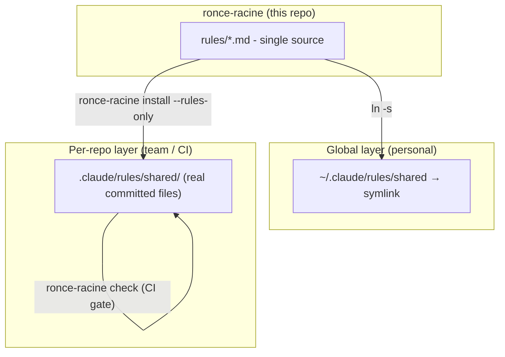

# Architecture

## The problem

Claude Code injects rules by file type via `.claude/rules/` (`paths:` frontmatter). For a long time each project kept its own copy of the "generic" rules in `rules/shared/`. Observed result: **the copies drift**. Across two projects, `commits.md` was identical but `secure-logging.md`, `test-discipline.md` and `detection-gap-protocol.md` had diverged (sections added on one side, not the other).

A generic rule should have **a single source of truth**.

## The solution: two layers

The user-level layer is machine-local and invisible to a teammate or a CI runner that only clones the project repo, which is why the per-repo layer exists: real committed files, since a symlink pointing outside the repo would point nowhere after a clone. The same drift problem applies to skills, hooks, agents and scripts, and `ronce-racine` covers all five families.

`plan` proposes only what the target's stack justifies, because the metadata of every installed skill loads in every session: installing everything would tax each one.

The mechanics - what `install` writes, the `settings.json` merge, the lockfile and its drift states, uninstall, the plugin layer: [distribution-model.md](distribution-model.md). The step-by-step procedure, including the `.adopted` record and `detach`: [adopting-a-repo.md](adopting-a-repo.md).
